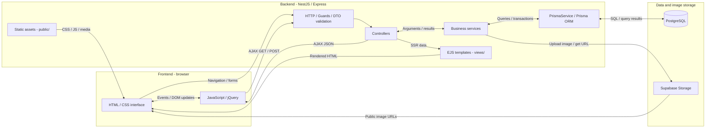

<!-- rg:start:hero -->


# LianTest

**Questions. Exams. Results. One workspace.**

An online examination system for students, teachers and administrators, built with NestJS and server-rendered EJS pages.

**English** · [Tiếng Việt](README.vi.md)

[Get started](#setup-and-first-run) · [Screenshots](#screenshots) · [Documentation](#documentation-and-api)

<!-- rg:end:hero -->

<!-- rg:start:overview -->

## Overview

LianTest brings question preparation, exam delivery and grading into one NestJS application. The current interface follows [DESIGN.md](DESIGN.md).

- **Accounts and permissions:** administrator, teacher and student roles, dynamic RBAC, profiles and email OTP password recovery.
- **Academic management:** years, semesters, subjects, chapters, teaching assignments and class groups.
- **Question bank:** multiple-choice, essay and reading questions, images, Word/Excel imports with previews before saving.
- **Exams:** manual or automatic question selection by difficulty, group assignments, timed attempts and submission.
- **Grading and results:** automatic grading for multiple-choice/reading questions, teacher grading for essays, statistics and Excel exports.
- **Print output:** result pages that use the browser's print dialog to save a PDF.
- **Public experience:** a landing page and an interactive sample quiz that requires no account.
<!-- rg:end:overview -->

<!-- rg:start:toc -->

## Contents

- [Overview](#overview)
- [Screenshots](#screenshots)
- [Tech stack](#tech-stack)
- [Prerequisites](#prerequisites)
- [Setup and first run](#setup-and-first-run)
- [Configuration](#configuration)
- [Project structure](#project-structure)
- [Architecture and request flow](#architecture-and-request-flow)
- [Usage and sample data](#usage-and-sample-data)
- [Testing](#testing)
- [Documentation and API](#documentation-and-api)
- [Author](#author)
<!-- rg:end:toc -->

<!-- rg:start:showcase -->

## Screenshots

Captured from the running application on **2026-10-18**, using an isolated local PostgreSQL fixture seeded from the repository JSON and a local Storage fixture. Desktop: **1440 × 1000**; mobile: **430 × 932**.


| Administrator dashboard                                         | Teacher question bank                                                                      |
| --------------------------------------------------------------- | ------------------------------------------------------------------------------------------ |
|    |                   |
| **Student exam schedule**                                       | **Mobile homepage**                                                                        |
|  |  |

The illustrated exam cards on the homepage are product examples; the authenticated pages display seeded application data.

<!-- rg:end:showcase -->

<!-- rg:start:tech-stack -->

## Tech stack

| Layer          | Technology                           | Role                                          |
| -------------- | ------------------------------------ | --------------------------------------------- |
| Server         | NestJS 11, TypeScript, Express       | Modules, services and validation              |
| UI             | EJS, Bootstrap/Dashmix, jQuery       | Server-rendered pages and AJAX                |
| Database       | PostgreSQL, Prisma 7                 | Persistence, schema and migrations            |
| Authentication | Passport JWT, bcrypt                 | Access-token cookies and password hashing     |
| Authorization  | Guards and permission decorators     | Dynamic role permissions                      |
| Images         | Supabase Storage                     | File storage; the database stores public URLs |
| Documents      | Mammoth, ExcelJS, SheetJS            | Word imports and Excel imports/exports        |
| Email          | Nodemailer, EJS templates            | OTP and account-related email                 |
| Tests          | Jest, Supertest, Node.js test runner | Unit, HTTP E2E and frontend behavior          |

Dependency declarations and scripts: [package.json](package.json).

<!-- rg:end:tech-stack -->

<!-- rg:start:prerequisites -->

## Prerequisites

- **Node.js compatible with Prisma 7.** The installed Prisma CLI declares `^20.19 || ^22.12 || >=24.0`; this documentation session used Node.js 24.19.0.
- **pnpm** available in your terminal. `package.json` does not pin `engines` or `packageManager`.
- **PostgreSQL** accessible through `DATABASE_URL`.
- **Supabase Storage:** a public bucket and server credentials permitted to upload/delete images.
- **SMTP settings**, including sender and support addresses. The email service checks these during startup.

This workspace's application repository is `NestJS/`. Run commands from the directory containing `package.json`. By project convention, `pnpm-lock.yaml` and `pnpm-workspace.yaml` are local-only and ignored by Git.

<!-- rg:end:prerequisites -->

<!-- rg:start:setup -->

## Setup and first run

### 1. Install and configure

```powershell
pnpm install
if (!(Test-Path .env)) { Copy-Item .env.example .env }
```

Edit `.env` using [the example](.env.example) and the [configuration table](#configuration). Supply database, JWT, Storage and email settings. Keep `SEED_DB=false` and `CLEAR_DB=false` for normal startup.

### 2. Prepare the database and start

Apply migrations to the database intended for the application. The seed commands below initialize a fresh local/test database with accounts and sample business data.

```powershell
pnpm exec prisma generate
pnpm exec prisma migrate deploy
pnpm run build
pnpm run seed:check
node scripts/seed-exam.cjs
node scripts/seed-demo.cjs
pnpm run start:dev
```

With the example's `PORT=8080`, open `http://localhost:8080/` or sign in at `http://localhost:8080/auth/signin`. See [sample accounts](#usage-and-sample-data). For an existing database, use its accounts and read the [seed guide](src/seed-db/data/README.md) before seeding.

`DATABASE_URL` supports direct PostgreSQL (`postgres://`, `postgresql://`) or Prisma Accelerate (`prisma://`, `prisma+postgres://`). Startup runs `SELECT 1` before reporting a successful connection.

### 3. Run the production build

Set `MODE=production` in the runtime environment, then:

```powershell
pnpm run build
pnpm run start:prod
```

The entrypoint is `dist/src/main.js`. Run from the project root and retain runtime dependencies, `views/`, `public/` and `src/email/templates/`; the application resolves these resources from its working directory.

<!-- rg:end:setup -->

<!-- rg:start:env-vars -->

## Configuration

Cross-checked against [.env.example](.env.example) and the current services. Supply credentials for your own environment.

| Variable                                 | Purpose                                                     | Template value / requirement                              |
| ---------------------------------------- | ----------------------------------------------------------- | --------------------------------------------------------- |
| `DATABASE_URL`                           | PostgreSQL or Prisma Accelerate connection                  | Required; replace the placeholder URL                     |
| `JWT_ACCESS_TOKEN_SECRET`                | Signs access JWTs                                           | Required; provide your own secret                         |
| `JWT_ACCESS_EXPIRE`                      | Access-token lifetime                                       | `10m` in the template                                     |
| `ACCESS_TOKEN_COOKIE`                    | JWT cookie for SSR authentication                           | `access_token`                                            |
| `SUPABASE_URL`, `SUPABASE_KEY`           | Server-side Storage connection                              | Required                                                  |
| `SUPABASE_NAME_BUCKET`                   | Public bucket for question, answer, essay and avatar images | Required                                                  |
| `EMAIL_HOST`, `EMAIL_PORT`               | SMTP server                                                 | Required host; port defaults to `587`                     |
| `EMAIL_AUTH_USER`, `EMAIL_AUTH_PASS`     | SMTP authentication                                         | Required at startup                                       |
| `EMAIL_FROM`, `SUPPORT_EMAIL`            | Sender and support addresses                                | Both required at startup                                  |
| `APP_NAME`                               | Name used in email templates                                | `LianHarman` in the template                              |
| `MODE`                                   | Enables Swagger and development error details               | `development`                                             |
| `PORT`, `HOST`                           | HTTP port and hostname in startup logs                      | `8080`, `localhost`; `HOST` does not set the bind address |
| `GLOBAL_PREFIX`, `VERSION`               | Infrastructure route prefix/version                         | `api`, `1`; examination pages use root paths              |
| `LIMIT_UPLOAD_FILE_SIZEMB`               | Upload limit                                                | `50` MB                                                   |
| `DEFAULT_PASSWORD`, `BCRYPT_SALT_ROUNDS` | Password and hashing cost for new seed accounts             | Set a password before seeding; cost `10`                  |
| `SEED_DB`, `CLEAR_DB`                    | Startup seed and clear controls                             | Both `false`                                              |
| `SEED_DEMO_DATA`                         | Business samples when startup seeding is enabled            | `false`                                                   |
| `SEED_DATA_DIR`                          | Replacement directory for the complete JSON dataset         | Unset: bundled dataset                                    |
| `EXPORT_SWAGGER_API_JSON`                | Exports `docs_API/swagger.json` when Swagger is enabled     | `true` in the template                                    |

`CLEAR_DB=true` and CLI clear options delete data. Use them only with a disposable database. Keep the Storage key on the server; images are served through public URLs.

<!-- rg:end:env-vars -->

<!-- rg:start:project-structure -->

## Project structure

```text
NestJS/
├── src/
│   ├── exam-auth/           # Sign-in, registration and password recovery
│   ├── roles/, users/      # Accounts and dynamic permissions
│   ├── academic-years/     # Academic years and semesters
│   ├── subjects/           # Subjects and chapters
│   ├── questions/          # Question bank and import parsers
│   ├── exams/              # Exams, attempts, grading and exports
│   ├── class-modules/      # Teacher groups and memberships
│   ├── assignments/        # Teaching assignments
│   ├── client/             # Student groups and schedules
│   ├── announcements/      # Group notifications
│   ├── statistic/          # Result statistics
│   ├── prisma/, storage/   # Database and image services
│   └── seed-db/data/       # 11 editable seed JSON files
├── prisma/                 # Schema and migrations
├── views/                  # EJS pages and partials
├── public/                 # CSS, JavaScript, icons and local plugins
├── scripts/                # Seed/check utilities
├── test/                   # HTTP E2E and frontend behavior tests
├── docs/                   # Architecture, project guides and screenshots
└── docs_API/               # Current API reference
```

Requests pass through authentication/permission guards to controllers and services. EJS renders pages; jQuery uses the existing AJAX contracts. Services access PostgreSQL through Prisma and upload images to Supabase Storage. See the [module architecture](docs/04-kien-truc-module.md).

<!-- rg:end:project-structure -->

<!-- rg:start:architecture -->

## Architecture and request flow

LianTest is one NestJS SSR application. The browser runs the HTML/CSS interface and JavaScript/jQuery; EJS templates render on the server. The backend boxes below are internal layers of the same application.



1. **Interface → frontend:** a user navigates, submits a form or triggers a JavaScript/jQuery handler. The browser loads static assets from `/public/`.
2. **Frontend → backend:** HTTP requests reach NestJS/Express. Guards apply JWT/RBAC rules where required; validation checks DTO input before the controller calls a business service.
3. **Backend → ORM → database:** services call `PrismaService` to query/update PostgreSQL or run transactions. The connection uses the PostgreSQL adapter or Prisma Accelerate, according to `DATABASE_URL`.
4. **Database → interface:** results return through Prisma → service → controller. For SSR, EJS renders HTML; for AJAX, the endpoint returns JSON and frontend code updates the DOM.
5. **Images:** services upload through `SupabaseStorageService`. PostgreSQL stores image URLs, and the browser loads image bytes from Supabase Storage.

Source: [HTTP, static files and EJS setup](src/main.ts), [global guards and modules](src/app.module.ts), [Prisma service](src/prisma/prisma.service.ts) and [Storage service](src/storage/supabase-storage.service.ts).

<!-- rg:end:architecture -->

<!-- rg:start:how-it-works -->

## Usage and sample data

| Role          | Sample account | Workflow                                                                        |
| ------------- | -------------- | ------------------------------------------------------------------------------- |
| Administrator | `admin`        | Manage accounts, permissions, academic years, subjects and assignments          |
| Teacher       | `gv001`        | Prepare questions → create an exam → assign groups → review and grade           |
| Student       | `sv001`        | Join a group → open the schedule → take/submit an exam → view available results |

Use the `DEFAULT_PASSWORD` configured when the accounts were seeded. Accounts are defined in [users.json](src/seed-db/data/users.json); editing JSON does not change an existing account's password or profile.

The dataset contains **11 JSON files** for roles, permissions, accounts, academic data, questions, groups and exams. After editing them, validate:

```powershell
pnpm run seed:check
```

Build once after changing TypeScript; source JSON changes are subsequently read without rebuilding. Validation checks structure and references without a database connection. `SEED_DATA_DIR` selects a complete alternative dataset. Existing rows are skipped according to the seed rules rather than automatically synchronized. See the [seed data guide](src/seed-db/data/README.md).

<!-- rg:end:how-it-works -->

<!-- rg:start:testing -->

## Testing

```powershell
pnpm run build
pnpm run lint
pnpm test --runInBand
pnpm run test:e2e --runInBand
node --test test/frontend/landing-demo.test.cjs test/frontend/signup.test.cjs
```

`lint` includes `--fix`. Unit tests use Jest; E2E tests exercise HTTP routes with Supertest. Business E2E tests need a separate PostgreSQL database, test Storage and demo accounts/groups/questions/exams; they create temporary data and clean it up. Missing prerequisites must fail tests. The `app`, `public-pages` and `setup-app` suites cover public pages and the harness without a database connection.

See [project status](docs/03-tien-do.md) for recorded checks. Browser verification of the live exam image-draft/submission flow requires external CDN assets; see the [development and testing guide](docs/07-so-tay-agent.md).

<!-- rg:end:testing -->

<!-- rg:start:api-docs -->

## Documentation and API

Examination pages and AJAX endpoints use root paths such as `/auth/signin`, `/dashboard`, `/question`, `/test` and `/client/test`, without `/api/v1`. AJAX responses retain their endpoint-specific object/array/boolean shapes.

- **Swagger:** `/swagger`, enabled only with `MODE=development`.
- [Current API and Excel question import contract](docs_API/README.md).
- [Seed JSON reference and customization](src/seed-db/data/README.md).
- [Documentation index](docs/README.md) and [development conventions](CLAUDE.md).
- [Project status and verification](docs/03-tien-do.md).
- [Module architecture](docs/04-kien-truc-module.md).
- [Supabase image storage and cleanup](docs/06-luu-tru-file-supabase.md).
- [Development, testing and current limitations](docs/07-so-tay-agent.md).
<!-- rg:end:api-docs -->

<!-- rg:start:authors -->

## Author

Created by **LianHarman** (`LienThuan04`), as credited in [package.json](package.json).

<!-- rg:end:authors -->

<!-- readme-generator: mode=project commit=7b62ca2fb117c5149a290445f9a45313f61fdb98 date=2026-10-18T07:20:20Z sections=hero,overview,toc,showcase,tech-stack,prerequisites,setup,env-vars,project-structure,architecture,how-it-works,testing,api-docs,authors -->
