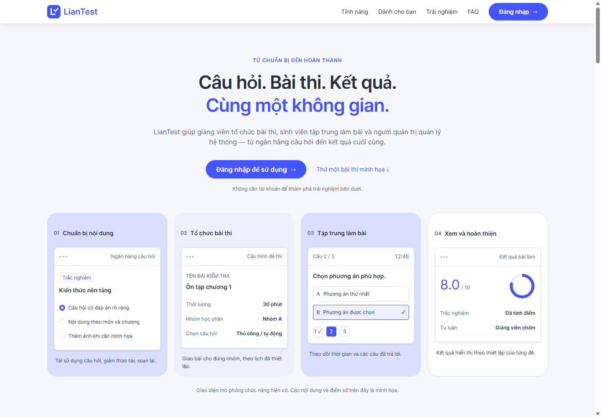
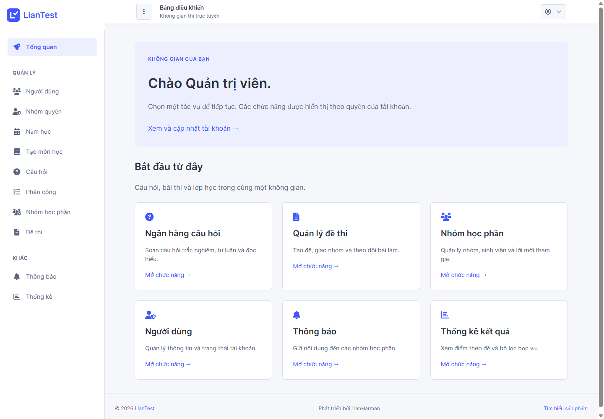
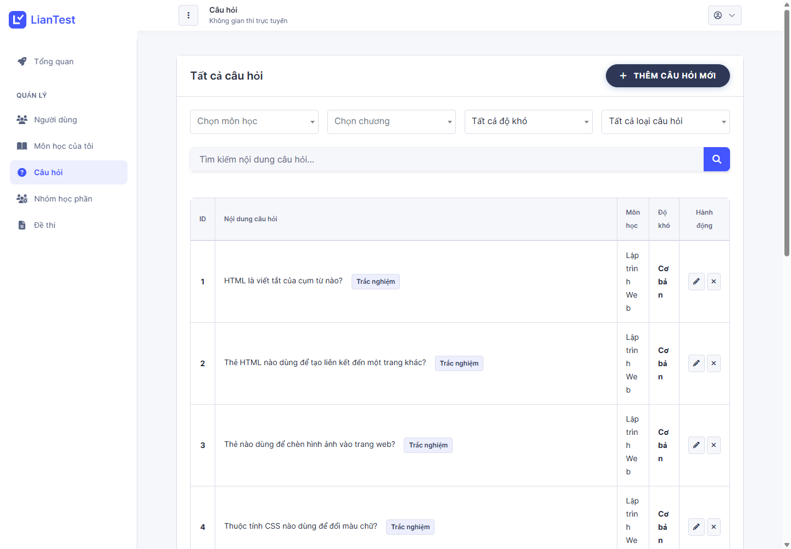
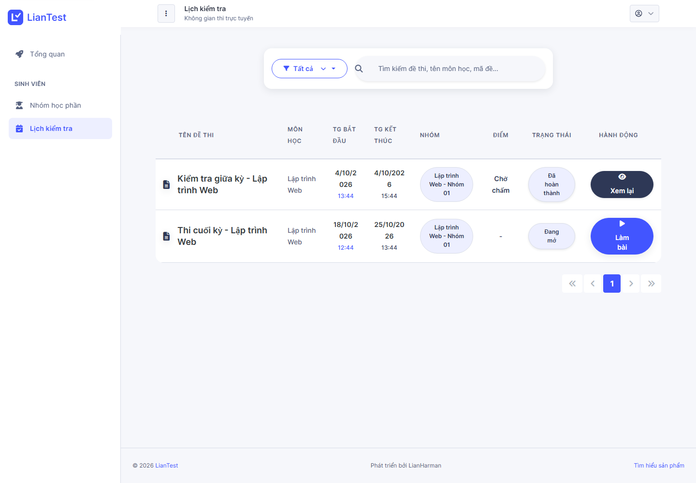
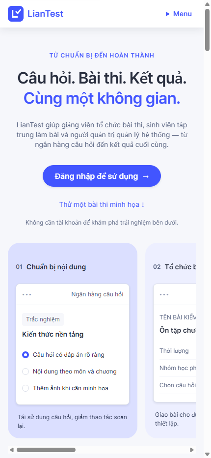
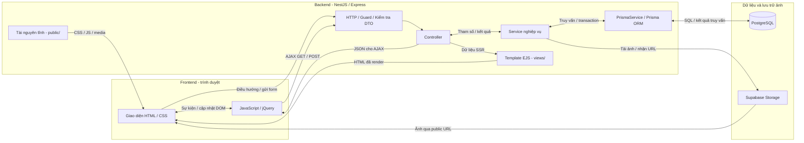

<!-- rg:start:hero -->


# LianTest

**Câu hỏi. Bài thi. Kết quả. Cùng một không gian.**

Hệ thống thi trực tuyến dành cho sinh viên, giảng viên và quản trị viên, xây dựng bằng NestJS và giao diện EJS render phía server.

[English](README.md) · **Tiếng Việt**

[Bắt đầu](#cài-đặt-và-chạy-local) · [Ảnh giao diện](#ảnh-giao-diện) · [Tài liệu](#tài-liệu-và-api)

<!-- rg:end:hero -->

<!-- rg:start:overview -->

## Tổng quan

LianTest tập trung việc chuẩn bị câu hỏi, tổ chức thi và chấm điểm trong cùng một ứng dụng. Dự án chuyển hệ `DHT_OneTest` từ PHP MVC sang NestJS, giữ các luồng nghiệp vụ thi và hợp đồng đường dẫn. Giao diện hiện tại triển khai theo [DESIGN.md](DESIGN.md).

- **Tài khoản và phân quyền:** quản trị viên, giảng viên, sinh viên; RBAC động, hồ sơ và khôi phục mật khẩu bằng OTP email.
- **Quản lý đào tạo:** năm học, học kỳ, môn, chương, phân công giảng dạy và nhóm học phần.
- **Ngân hàng câu hỏi:** trắc nghiệm, tự luận, đọc hiểu, hình ảnh; nhập Word/Excel và xem trước trước khi lưu.
- **Tổ chức thi:** chọn câu thủ công hoặc tự động theo độ khó, giao đề cho nhóm, giới hạn thời gian và nộp bài.
- **Chấm điểm và kết quả:** tự động chấm trắc nghiệm/đọc hiểu, giảng viên chấm tự luận, thống kê và xuất Excel.
- **Trang in:** dùng hộp thoại in của trình duyệt để lưu kết quả thành PDF.
- **Trải nghiệm công khai:** landing page và bài thi minh họa tương tác không cần tài khoản.
<!-- rg:end:overview -->

<!-- rg:start:toc -->

## Mục lục

- [Tổng quan](#tổng-quan)
- [Ảnh giao diện](#ảnh-giao-diện)
- [Công nghệ](#công-nghệ)
- [Yêu cầu môi trường](#yêu-cầu-môi-trường)
- [Cài đặt và chạy local](#cài-đặt-và-chạy-local)
- [Biến môi trường](#biến-môi-trường)
- [Cấu trúc dự án](#cấu-trúc-dự-án)
- [Kiến trúc và luồng xử lý](#kiến-trúc-và-luồng-xử-lý)
- [Sử dụng và dữ liệu mẫu](#sử-dụng-và-dữ-liệu-mẫu)
- [Kiểm thử](#kiểm-thử)
- [Tài liệu và API](#tài-liệu-và-api)
- [Tác giả](#tác-giả)
<!-- rg:end:toc -->

<!-- rg:start:showcase -->

## Ảnh giao diện

Chụp từ ứng dụng đang chạy vào **2026-10-18**, sử dụng PostgreSQL cục bộ riêng với dữ liệu seed từ JSON trong repo và Storage thử nghiệm cục bộ. Ảnh desktop: **1440 × 1000**; mobile: **430 × 932**.



| Dashboard quản trị viên                                       | Ngân hàng câu hỏi của giảng viên                                                              |
| ------------------------------------------------------------- | --------------------------------------------------------------------------------------------- |
|  |                        |
| **Lịch thi sinh viên**                                        | **Trang chủ trên mobile**                                                                     |
|   |  |

Các thẻ bài thi trên trang chủ là minh họa sản phẩm; các trang sau đăng nhập hiển thị dữ liệu mẫu đã seed vào ứng dụng.

<!-- rg:end:showcase -->

<!-- rg:start:tech-stack -->

## Công nghệ

| Thành phần    | Công nghệ                            | Vai trò                             |
| ------------- | ------------------------------------ | ----------------------------------- |
| Server        | NestJS 11, TypeScript, Express       | Module, service và kiểm tra dữ liệu |
| Giao diện     | EJS, Bootstrap/Dashmix, jQuery       | Render phía server và AJAX          |
| Cơ sở dữ liệu | PostgreSQL, Prisma 7                 | Lưu trữ, schema và migration        |
| Xác thực      | Passport JWT, bcrypt                 | Cookie access token và băm mật khẩu |
| Phân quyền    | Guard và permission decorator        | Quyền động theo nhóm                |
| Hình ảnh      | Supabase Storage                     | Lưu file; DB chỉ lưu public URL     |
| Tài liệu      | Mammoth, ExcelJS, SheetJS            | Nhập Word, nhập/xuất Excel          |
| Email         | Nodemailer, template EJS             | OTP và email liên quan tài khoản    |
| Kiểm thử      | Jest, Supertest, Node.js test runner | Unit, HTTP E2E và hành vi frontend  |

Khai báo dependency và script: [package.json](package.json).

<!-- rg:end:tech-stack -->

<!-- rg:start:prerequisites -->

## Yêu cầu môi trường

- **Node.js tương thích Prisma 7.** Prisma CLI đang cài khai báo `^20.19 || ^22.12 || >=24.0`; phiên kiểm tra tài liệu này dùng Node.js 24.19.0.
- **pnpm** dùng được trong terminal. `package.json` chưa khai báo cố định `engines` hoặc `packageManager`.
- **PostgreSQL** truy cập được qua `DATABASE_URL`.
- **Supabase Storage:** bucket public và khóa phía server được phép tải lên/xóa ảnh.
- **Cấu hình SMTP**, gồm địa chỉ gửi và hỗ trợ. Dịch vụ email kiểm tra các giá trị này ngay khi startup.

Trong workspace này, repo ứng dụng nằm tại `NestJS/`. Chạy lệnh ở thư mục chứa `package.json`. Theo quy ước dự án, `pnpm-lock.yaml` và `pnpm-workspace.yaml` chỉ lưu local và được Git bỏ qua.

<!-- rg:end:prerequisites -->

<!-- rg:start:setup -->

## Cài đặt và chạy local

### 1. Cài gói và cấu hình

```powershell
pnpm install
if (!(Test-Path .env)) { Copy-Item .env.example .env }
```

Chỉnh `.env` theo [file mẫu](.env.example) và [bảng cấu hình](#biến-môi-trường). Điền kết nối DB, JWT, Storage và email. Giữ `SEED_DB=false`, `CLEAR_DB=false` khi khởi động bình thường.

### 2. Chuẩn bị DB và khởi động

Áp migration vào DB dành cho ứng dụng. Các lệnh seed dưới đây khởi tạo tài khoản và dữ liệu nghiệp vụ mẫu cho DB local/test mới.

```powershell
pnpm exec prisma generate
pnpm exec prisma migrate deploy
pnpm run build
pnpm run seed:check
node scripts/seed-exam.cjs
node scripts/seed-demo.cjs
pnpm run start:dev
```

Với `PORT=8080` trong file mẫu, mở `http://localhost:8080/` hoặc đăng nhập tại `http://localhost:8080/auth/signin`. Xem [tài khoản mẫu](#sử-dụng-và-dữ-liệu-mẫu). Nếu DB đã có dữ liệu, dùng tài khoản hiện có và đọc [hướng dẫn seed](src/seed-db/data/README.md) trước khi chạy seed.

`DATABASE_URL` hỗ trợ PostgreSQL trực tiếp (`postgres://`, `postgresql://`) hoặc Prisma Accelerate (`prisma://`, `prisma+postgres://`). Startup chạy `SELECT 1` trước khi báo kết nối thành công.

### 3. Chạy bản build production

Đặt `MODE=production` trong môi trường chạy, sau đó:

```powershell
pnpm run build
pnpm run start:prod
```

Entrypoint là `dist/src/main.js`. Chạy từ thư mục gốc dự án và giữ dependency runtime, `views/`, `public/`, `src/email/templates/`; ứng dụng tìm các tài nguyên này theo thư mục làm việc.

<!-- rg:end:setup -->

<!-- rg:start:env-vars -->

## Biến môi trường

Đã đối chiếu với [.env.example](.env.example) và service hiện tại. Tự điền thông tin kết nối cho môi trường của bạn.

| Biến                                     | Mục đích                                                  | Giá trị mẫu / yêu cầu                              |
| ---------------------------------------- | --------------------------------------------------------- | -------------------------------------------------- |
| `DATABASE_URL`                           | Kết nối PostgreSQL hoặc Prisma Accelerate                 | Bắt buộc; thay URL giữ chỗ                         |
| `JWT_ACCESS_TOKEN_SECRET`                | Ký access JWT                                             | Bắt buộc; đặt secret riêng                         |
| `JWT_ACCESS_EXPIRE`                      | Thời hạn access token                                     | File mẫu đặt `10m`                                 |
| `ACCESS_TOKEN_COOKIE`                    | Cookie JWT cho xác thực SSR                               | `access_token`                                     |
| `SUPABASE_URL`, `SUPABASE_KEY`           | Kết nối Storage phía server                               | Bắt buộc                                           |
| `SUPABASE_NAME_BUCKET`                   | Bucket public chứa ảnh câu hỏi, đáp án, tự luận và avatar | Bắt buộc                                           |
| `EMAIL_HOST`, `EMAIL_PORT`               | Máy chủ SMTP                                              | Bắt buộc host; port mặc định `587`                 |
| `EMAIL_AUTH_USER`, `EMAIL_AUTH_PASS`     | Đăng nhập SMTP                                            | Bắt buộc khi startup                               |
| `EMAIL_FROM`, `SUPPORT_EMAIL`            | Địa chỉ gửi và hỗ trợ                                     | Cả hai bắt buộc khi startup                        |
| `APP_NAME`                               | Tên trong template email                                  | File mẫu đặt `LianHarman`                          |
| `MODE`                                   | Bật Swagger và chi tiết lỗi development                   | `development`                                      |
| `PORT`, `HOST`                           | Cổng HTTP và hostname trong log startup                   | `8080`, `localhost`; `HOST` không đặt địa chỉ bind |
| `GLOBAL_PREFIX`, `VERSION`               | Prefix/version của route hạ tầng                          | `api`, `1`; trang hệ thi dùng path gốc             |
| `LIMIT_UPLOAD_FILE_SIZEMB`               | Giới hạn upload                                           | `50` MB                                            |
| `DEFAULT_PASSWORD`, `BCRYPT_SALT_ROUNDS` | Mật khẩu và độ khó băm cho tài khoản seed mới             | Đặt mật khẩu trước khi seed; độ khó `10`           |
| `SEED_DB`, `CLEAR_DB`                    | Điều khiển seed và clear khi startup                      | Cả hai `false`                                     |
| `SEED_DEMO_DATA`                         | Dữ liệu nghiệp vụ khi bật startup seed                    | `false`                                            |
| `SEED_DATA_DIR`                          | Thư mục thay thế toàn bộ bộ JSON seed                     | Bỏ trống: dữ liệu kèm repo                         |
| `EXPORT_SWAGGER_API_JSON`                | Xuất `docs_API/swagger.json` khi Swagger được bật         | File mẫu đặt `true`                                |

`CLEAR_DB=true` và các tùy chọn clear của CLI sẽ xóa dữ liệu. Chỉ dùng trên DB thử nghiệm có thể bỏ đi. Giữ khóa Storage ở server; ảnh được phục vụ qua public URL.

<!-- rg:end:env-vars -->

<!-- rg:start:project-structure -->

## Cấu trúc dự án

```text
NestJS/
├── src/
│   ├── exam-auth/           # Đăng nhập, đăng ký và khôi phục mật khẩu
│   ├── roles/, users/      # Tài khoản và quyền động
│   ├── academic-years/     # Năm học và học kỳ
│   ├── subjects/           # Môn học và chương
│   ├── questions/          # Ngân hàng câu hỏi và bộ đọc file nhập
│   ├── exams/              # Đề, bài làm, chấm điểm và xuất kết quả
│   ├── class-modules/      # Nhóm và thành viên của giảng viên
│   ├── assignments/        # Phân công giảng dạy
│   ├── client/             # Nhóm và lịch thi sinh viên
│   ├── announcements/      # Thông báo nhóm
│   ├── statistic/          # Thống kê kết quả
│   ├── prisma/, storage/   # Dịch vụ DB và ảnh
│   └── seed-db/data/       # 11 file JSON dữ liệu mẫu có thể chỉnh sửa
├── prisma/                 # Schema và migration
├── views/                  # Trang và partial EJS
├── public/                 # CSS, JavaScript, icon và plugin local
├── scripts/                # Tiện ích seed/kiểm tra
├── test/                   # HTTP E2E và kiểm thử hành vi frontend
├── docs/                   # Kiến trúc, bàn giao và ảnh giao diện
└── docs_API/               # Tài liệu API hiện tại
```

Request qua guard xác thực/phân quyền đến controller và service. EJS render trang; jQuery gọi các hợp đồng AJAX hiện có. Service truy cập PostgreSQL qua Prisma và tải ảnh lên Supabase Storage. Xem [kiến trúc module](docs/04-kien-truc-module.md).

<!-- rg:end:project-structure -->

<!-- rg:start:architecture -->

## Kiến trúc và luồng xử lý

LianTest là một ứng dụng NestJS SSR. Trình duyệt chạy giao diện HTML/CSS và JavaScript/jQuery; template EJS được render ở server. Các ô backend bên dưới là các tầng xử lý nội bộ của cùng ứng dụng.



1. **Giao diện → frontend:** người dùng điều hướng, gửi form hoặc kích hoạt trình xử lý JavaScript/jQuery. Trình duyệt tải tài nguyên tĩnh từ `/public/`.
2. **Frontend → backend:** request HTTP đến NestJS/Express. Guard áp dụng JWT/RBAC ở route cần quyền; validation kiểm tra dữ liệu DTO trước khi controller gọi service nghiệp vụ.
3. **Backend → ORM → database:** service gọi `PrismaService` để đọc/ghi PostgreSQL hoặc thực hiện transaction. Kết nối dùng adapter PostgreSQL hoặc Prisma Accelerate tùy `DATABASE_URL`.
4. **Database → giao diện:** kết quả đi ngược qua Prisma → service → controller. Với SSR, EJS render HTML; với AJAX, endpoint trả JSON để frontend cập nhật DOM.
5. **Hình ảnh:** service tải ảnh qua `SupabaseStorageService`. PostgreSQL lưu URL ảnh; trình duyệt tải dữ liệu ảnh từ Supabase Storage.

Mã nguồn: [thiết lập HTTP, file tĩnh và EJS](src/main.ts), [guard và module toàn cục](src/app.module.ts), [Prisma service](src/prisma/prisma.service.ts) và [Storage service](src/storage/supabase-storage.service.ts).

<!-- rg:end:architecture -->

<!-- rg:start:how-it-works -->

## Sử dụng và dữ liệu mẫu

| Vai trò       | Tài khoản mẫu | Luồng sử dụng                                                        |
| ------------- | ------------- | -------------------------------------------------------------------- |
| Quản trị viên | `admin`       | Quản lý người dùng, quyền, năm học, môn và phân công                 |
| Giảng viên    | `gv001`       | Chuẩn bị câu hỏi → tạo đề → giao nhóm → xem và chấm bài              |
| Sinh viên     | `sv001`       | Tham gia nhóm → mở lịch thi → làm/nộp bài → xem kết quả được công bố |

Dùng `DEFAULT_PASSWORD` đã cấu hình tại thời điểm seed tài khoản. Tài khoản được khai báo trong [users.json](src/seed-db/data/users.json); sửa JSON không thay mật khẩu hoặc hồ sơ tài khoản đã tồn tại.

Bộ dữ liệu gồm **11 file JSON** cho nhóm quyền, quyền, tài khoản, dữ liệu đào tạo, câu hỏi, nhóm và đề thi. Sau khi chỉnh sửa, kiểm tra:

```powershell
pnpm run seed:check
```

Build một lần sau khi đổi TypeScript; những lần chỉ sửa JSON nguồn được đọc lại mà không cần build. Bước kiểm tra xác thực cấu trúc và tham chiếu, không cần kết nối DB. `SEED_DATA_DIR` chọn một bộ dữ liệu thay thế đầy đủ. Dữ liệu đã có được bỏ qua theo quy tắc seed, không tự đồng bộ theo JSON. Xem [hướng dẫn dữ liệu seed](src/seed-db/data/README.md).

<!-- rg:end:how-it-works -->

<!-- rg:start:testing -->

## Kiểm thử

```powershell
pnpm run build
pnpm run lint
pnpm test --runInBand
pnpm run test:e2e --runInBand
node --test test/frontend/landing-demo.test.cjs test/frontend/signup.test.cjs
```

Script `lint` có `--fix`. Unit test dùng Jest; E2E kiểm tra HTTP bằng Supertest. E2E nghiệp vụ cần PostgreSQL riêng, Storage test và dữ liệu tài khoản/nhóm/câu hỏi/đề mẫu; các ca tạo dữ liệu tạm rồi tự dọn. Thiếu điều kiện tiên quyết phải làm test thất bại. Các bộ `app`, `public-pages`, `setup-app` kiểm tra trang công khai và harness mà không cần kết nối DB.

Kết quả lịch sử: [sổ tiến độ](docs/03-tien-do.md). Kiểm chứng đầy đủ trên trình duyệt cho luồng ảnh nháp/nộp bài thi vẫn có giới hạn CDN bên ngoài, ghi tại [báo cáo frontend](docs/14-frontend-migration-verification.md).

<!-- rg:end:testing -->

<!-- rg:start:api-docs -->

## Tài liệu và API

Trang nghiệp vụ và AJAX hệ thi dùng path gốc như `/auth/signin`, `/dashboard`, `/question`, `/test`, `/client/test`, không mang `/api/v1`. Phản hồi AJAX giữ dạng object/mảng/boolean riêng của từng endpoint.

- **Swagger:** `/swagger`, chỉ bật khi `MODE=development`.
- [API hiện tại và hợp đồng nhập câu hỏi Excel](docs_API/README.md).
- [Hướng dẫn và tùy chỉnh dữ liệu seed JSON](src/seed-db/data/README.md).
- [Sổ tay tiếp quản](docs/README.md) và [quy ước phát triển](CLAUDE.md).
- [Tiến độ và lịch sử kiểm chứng](docs/03-tien-do.md).
- [Kiến trúc module](docs/04-kien-truc-module.md) và [ánh xạ chuyển đổi PHP](docs/05-anh-xa-va-nguon-php.md).
- [Lưu ảnh Supabase và dọn ảnh hết tham chiếu](docs/06-luu-tru-file-supabase.md).
- [Kiểm chứng frontend và giới hạn còn lại](docs/14-frontend-migration-verification.md).
- [Audit media LianTest](docs/15-media-audit.md).
<!-- rg:end:api-docs -->

<!-- rg:start:authors -->

## Tác giả

Phát triển bởi **LianHarman** (`LienThuan04`), theo thông tin trong [package.json](package.json).

<!-- rg:end:authors -->

<!-- readme-generator: mode=project commit=69c1cd6d4f76c14872c4567f7b0e407ed60b3464 date=2026-10-18T07:12:06Z sections=hero,overview,toc,showcase,tech-stack,prerequisites,setup,env-vars,project-structure,architecture,how-it-works,testing,api-docs,authors -->
